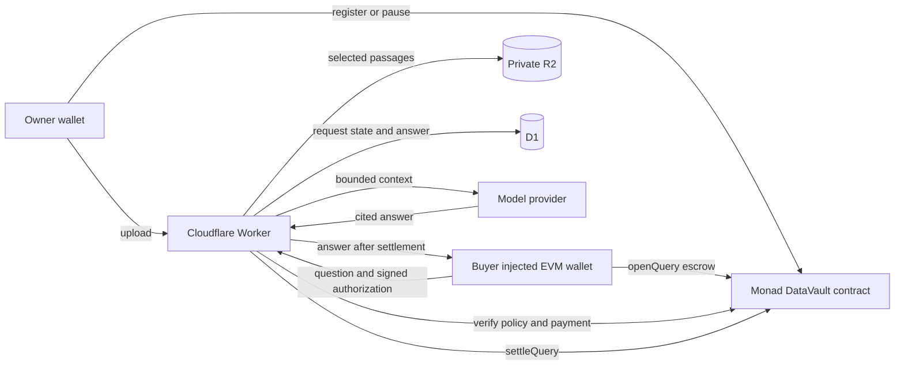

# DataVault project context

DataVault sells per-question access to private knowledge collections on Monad testnet. The owner sets a price and onchain policy; the buyer pays into escrow; the Worker verifies payment, retrieves selected private passages, calls a real model, and settles the owner payment before releasing a cited answer. This repository's primary Metropolis track is **Trust, Identity & AI Infrastructure**. No sponsor bounty was selected in the submitted entry.

The [README](README.md) is the product overview. The [judge quickstart](docs/demo-quickstart.md) is the current path through the live deployment. This file records architecture and trust boundaries. Earlier proposed integrations and numeric scale assumptions are preserved only in Git history.

## Architecture

The frontend is React and Vite. It uses an injected EVM provider and viem; it does **not** use Dynamic SDK or embedded wallet creation. The Worker serves the frontend and API. Solidity handles collection policy, fixed-price query escrow, owner settlement, and timeout refunds. The model provider is configurable; the public deployment was tested with Claude through its Messages API.

## Trust boundaries

- A wallet signature proves control of that wallet for this flow. It does not prove a real-world identity or legal ownership of uploaded content.
- The Worker checks the current onchain policy and matching successful payment before reading private R2 content.
- Selected passages are sent to the configured model provider. Neither full source text nor the buyer's private question is placed onchain.
- The public receipt records identifiers, payment evidence, citation identifiers, and an answer digest. It does not expose the private answer or certify its truth.
- Pausing stops future access through DataVault. It cannot erase answers already delivered or control unrelated AI systems.
- The settlement key and model key remain Worker secrets. Owners and buyers sign with their own wallets.

## Status and evidence

The [live app](https://datavault.tamimtarafder12.workers.dev/) and [public analytics](https://datavault.tamimtarafder12.workers.dev/analytics) show the deployed product and recorded settlements. [PR #68](https://github.com/ShieldTech-Ltd/datavault/pull/68) merged the Claude and onboarding changes. The Metropolis entry showed **Ready for judging** on 14 October 2026. See [request recovery](docs/request-recovery.md), [API contract](docs/api-contract.md), [security controls](docs/security.md), and [deployment runbook](docs/deployment.md) for detailed mechanisms and verification gates.
