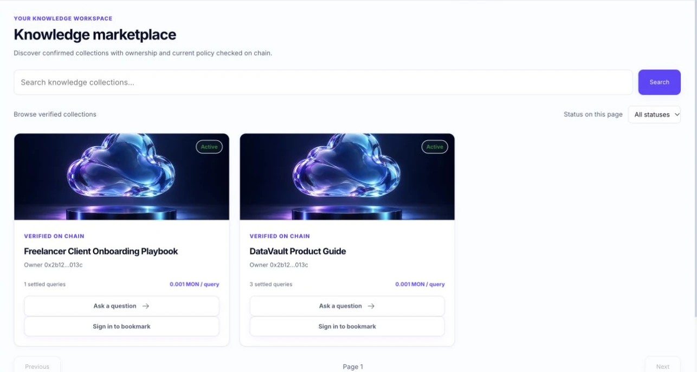
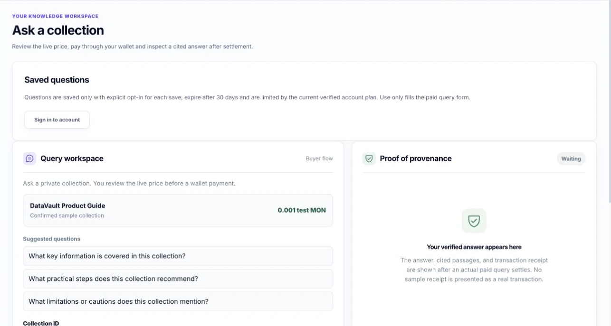
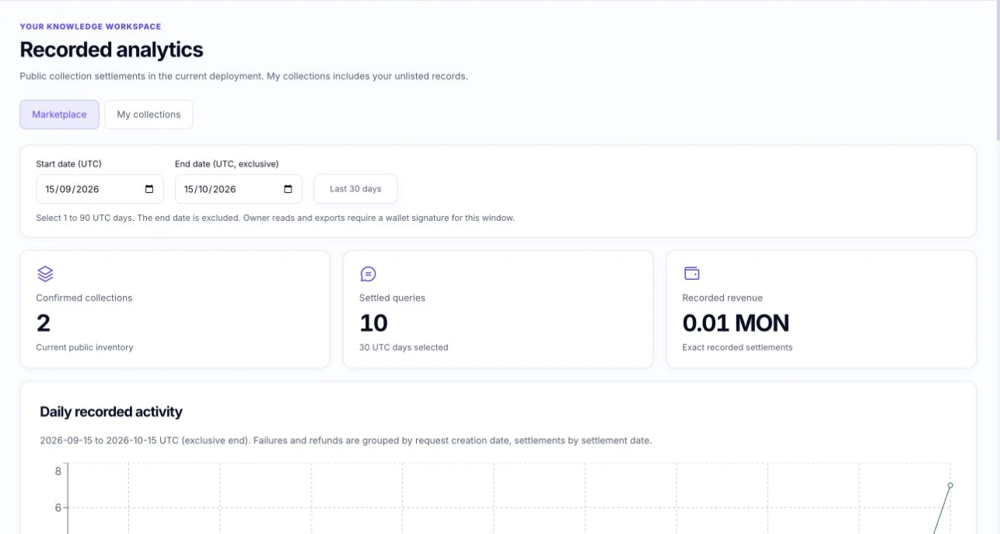

<p align="center">
  
</p>

<h1 align="center">DataVault</h1>

<p align="center"><strong>Paid, controlled AI access to private knowledge collections on Monad.</strong></p>

<p align="center">
  <a href="https://datavault.tamimtarafder12.workers.dev/">Live product</a> ·
  <a href="docs/demo-quickstart.md">Try it on testnet</a> ·
  <a href="https://drive.google.com/file/d/19YTD4yBQxM2qUid9Z4YmGXgBuTA5Y8sa/view?usp=sharing">Demo video</a> ·
  <a href="https://drive.google.com/file/d/1DuaVk97ce_5kSlH4zKF4TmkIPlC5JiRP/view?usp=sharing">Pitch video</a>
</p>

<p align="center"><em>Monad Metropolis · Trust, Identity &amp; AI Infrastructure · Public testnet beta</em></p>


An owner publishes a private knowledge collection, sets a per-question price, and registers its access policy on Monad testnet. A buyer puts test MON in escrow before asking. DataVault verifies that payment and the current policy, retrieves selected passages from private R2 storage, generates a cited answer with a real model, and releases the answer after onchain settlement pays the owner. Owners can pause future access; buyers can recover a completed answer or refund an unsettled escrow after its timeout.

| Publish | Ask | Verify | Control |
| --- | --- | --- | --- |
| Upload a collection and register its price and policy on Monad. | Review the current price and approve an escrow transaction. | Receive a cited answer after settlement and inspect its public receipt. | Pause future access or refund an unsettled payment after ten minutes. |

## Product screenshots

These are captures of the public deployment on 14 October 2026. Collection counts and settlement totals can change.

**Browse confirmed collections and their current price**



| Buyer workspace | Recorded settlements |
| --- | --- |
|  |  |

The screenshots show public or pre-payment states. Private source passages and buyer-only answers are not displayed as public proof.

## Verify a real paid request

The [public analytics](https://datavault.tamimtarafder12.workers.dev/analytics) links settlements to receipts and Monad transactions. One recorded request has a [public receipt](https://datavault.tamimtarafder12.workers.dev/api/queries/0xa68eb38f26e874622823b39da95adff329c684efa86149eaaeee350e71653f9e/receipt), [escrow opening transaction](https://testnet.monadscan.com/tx/0x69130f4f3054a20b656eb09ad765f777d308244bdf95de9ea8f9ba5369477663), and [owner payout transaction](https://testnet.monadscan.com/tx/0x862c17a568db323517108f4058fca06a813e45248ff43ead11578af180a7523c). The deployed contract is [0x304aca9375fbd2f645e6c2d0318effa407766430](https://testnet.monadscan.com/address/0x304aca9375fbd2f645e6c2d0318effa407766430).

The receipt exposes an answer digest and citation identifiers, not the private question, answer, or source text. Judges can run their own paid query using the [quickstart](docs/demo-quickstart.md).

## Live product and local preview

The live app uses an injected EVM wallet and Worker-backed data. The buyer route at `/query` handles paid queries, answer recovery, reconciliation and refunds. The owner route at `/manage` handles signed registration and policy updates. The local-only `/preview/query` route is a simulated interface for UI review and is excluded from the production build.

---

## What this is not

- It does not detect AI use of content outside this service.
- Content hashes are integrity references only. They do not prove copyright ownership.
- Revoking access blocks future queries through this service. It cannot erase answers already delivered.
- Selected passages are sent to the model provider to generate answers. Owners are told this before uploading.
- The source has security and release gates, but public service readiness depends on live checks and deployment configuration.

---

## Repository structure

```
contracts/          Solidity contract and Hardhat tests
  DataVault.sol     registerCollection, updatePolicy, openQuery, settleQuery, refundExpired
  test/             Hardhat contract tests
frontend/           React + Vite + TypeScript UI
  src/
    lib/            Injected wallet context, Monad network, viem contract client
    components/     Wallet, owner, buyer, and marketplace views
worker/             Cloudflare Worker API
  src/
    lib/            policy.ts, model.ts, r2.ts, d1.ts, types.ts
    routes/         collections, queries, catalogue, and analytics
    test/           Worker unit and route tests
  migrations/       D1 SQL schema
scripts/            Hardhat deploy script
demo/               Team-authored sample knowledge document
docs/               Architecture, API contract, testing guide, failure matrix, receipt format
shared/             Shared ABI constant
```

---

## Prerequisites

- Node.js 22.13+ (required by the frontend package)
- npm 9+
- Cloudflare account with Workers, R2, and D1 enabled
- Injected EVM wallet or wallet browser with Monad testnet and test MON
- AI model API key (Anthropic, OpenAI, or Kimi)

---

## Setup

### 1. Install dependencies

```sh
npm run install:all
```

This installs root (Hardhat), frontend, and worker dependencies.

### 2. Configure the frontend

```sh
cp frontend/.env.example frontend/.env
```

Fill in:
- `VITE_CONTRACT_ADDRESS` after deploying the contract (Step 4)

### 3. Configure the Worker

```sh
cp worker/.dev.vars.example worker/.dev.vars
```

Fill in:
- `CONTRACT_ADDRESS` after deployment
- `SETTLEMENT_PRIVATE_KEY` (funded Monad testnet key)
- `MODEL_API_KEY`

Create D1 database:

```sh
cd worker
npx wrangler d1 create datavault-db
```

For a public deployment, copy `worker/wrangler.toml` to the ignored `worker/wrangler.deploy.toml` and place the returned `database_id` there. Local Wrangler development uses its simulated D1 binding without a remote ID.

Apply the schema locally:

```sh
npm run db:migrate:local
```

### 4. Compile and deploy the contract

```sh
cp .env.example .env
# Set DEPLOYER_PRIVATE_KEY in .env
npm run compile
npm run deploy:testnet
```

Copy the deployed address into `frontend/.env` and `worker/.dev.vars`.

### 5. Run local development

Terminal 1: Worker API on port 8787

```sh
cd worker && npm run dev
```

Terminal 2: Frontend on port 5173 (proxies /api to Worker)

```sh
cd frontend && npm run dev
```

Open http://localhost:5173.

For UI and UX review without a wallet, open `http://localhost:5173/demo.html` while Vite is running. This local preview has sample owner and buyer states only. It makes no API, model, wallet, or Monad calls and is excluded from the production build. Use the main app and live acceptance checklist to verify real payments and answers.

---

## Build and deploy to Cloudflare

Complete [the deployment runbook](docs/deployment.md), including the release configuration checks and real resource bindings, before this command.

```sh
# Build the frontend
npm run build:frontend

# Deploy the Worker (serves the built frontend as static assets)
cd worker && npx wrangler deploy --config wrangler.deploy.toml
```

---

## Type checking

```sh
npm run typecheck:frontend
npm run typecheck:worker
```

---

## Tests

```sh
# Smart contract tests
npm run test:contracts

# Worker unit tests (no live chain or model calls)
cd worker && npm test
```

Contract tests cover: registerCollection, updatePolicy, openQuery, settleQuery, refundExpired, operator model, replay protection, timeout refund.

Worker tests cover: input validation, D1 state machine transitions, rate limiting, route auth and access control, catalogue filtering, and settlement analytics. See `docs/testing.md` for full scope and live gate documentation.

For a local paid-flow integration rehearsal using a Hardhat chain, Wrangler D1/R2, and an HTTPS model stub, follow [the local rehearsal steps](docs/testing.md#local-paid-flow-rehearsal) and run `npm run rehearse:local`. It does not replace Monad testnet acceptance testing.

---

## Environment variables reference

### Frontend (.env)

| Variable | Purpose |
|----------|---------|
| `VITE_CONTRACT_ADDRESS` | Deployed DataVault contract |
| `VITE_CHAIN_ID` | Monad testnet chain ID (default: 10143) |
| `VITE_CHAIN_RPC_URL` | Monad RPC (default: https://testnet-rpc.monad.xyz) |

### Worker (.dev.vars for local, `wrangler secret put` for production)

| Variable | Purpose |
|----------|---------|
| `CONTRACT_ADDRESS` | Deployed DataVault contract |
| `MONAD_RPC_URL` | Monad RPC endpoint |
| `SETTLEMENT_PRIVATE_KEY` | Key used by Worker to call settleQuery |
| `MODEL_API_KEY` | AI model provider key |
| `MODEL_PROVIDER` | `anthropic` (Claude Messages API), `openai`, or `kimi` |
| `MODEL_API_BASE` | HTTPS API base URL (provider default for Anthropic or OpenAI; required for `kimi`) |
| `MODEL_NAME` | Explicit model name for Anthropic or Kimi; OpenAI defaults to gpt-4o-mini |

---

## Optional test billing

Subscriptions are disabled by default. Wallet query payments, owner payouts, paid answer recovery and refunds remain independent. This adapter accepts Stripe **test mode only**. It does not enable live charges or choose commercial prices or higher limits.

Apply migration `0023_billing.sql` after all migrations through `0022`. Configure the following privately for the deployment, without committing `.dev.vars` or provider secrets:

| Setting | Required value |
| --- | --- |
| `BILLING_MODE` | `test` |
| `STRIPE_SECRET_KEY` | The deployment's private `sk_test_...` key |
| `STRIPE_WEBHOOK_SECRET` | Its endpoint's private `whsec_...` signing secret |
| `STRIPE_PRICE_ID` | An operator-approved, active, recurring, licensed test price |
| `PUBLIC_ORIGIN` | The exact trusted HTTPS origin, without a path or trailing slash |
| `BILLING_LIMITS` | JSON with exactly `activeKeys`, `ownedWorkspaces`, `workspaceMembers`, `importsPerDay`, `savedQuestions`, and `uploadBytes` |

Caps must be finite integers at least the existing free caps: 5 active keys, 5 owned workspaces, 50 members per workspace, 20 import jobs per rolling day, 50 active saved questions, and 2,097,152 upload bytes. Engineering ceilings are 100 keys, 100 owned workspaces, 500 seats, 200 daily imports, 1,000 saved questions, and exactly 2,097,152 upload bytes. These ceilings are validation boundaries, not promised paid-plan limits. Imports always permit only one inflight job. Cumulative storage billing is unavailable because exact persisted byte accounting is not implemented. No higher caps or price are supplied by default.

Configure a Stripe test webhook for `POST /api/billing/webhook` at the trusted origin, using the SDK API version `2026-09-30.endive`. Subscribe to `customer.subscription.*`, `invoice.*` and `checkout.session.*` activity. Configure the test customer portal in Stripe. Checkout and portal return only to `/settings/billing`. A checkout return remains pending until authoritative server verification. Missing or invalid configuration leaves Billing unavailable with no sample invoices.

Only a single current subscription with the configured price, status `active` or `trialing`, and an unexpired verified item period grants configured caps. Scheduled cancellation preserves caps through that verified period. `past_due`, `unpaid`, cancellation, ambiguity, expiry, provider failure or stale evidence downgrade new usage to free without deleting existing records. Evidence is valid for at most 15 minutes; visiting Billing refreshes stale evidence from Stripe. Quota checks evaluate the current configuration and evidence atomically with inserts. Workspaces inherit their creator's billing limits for seats, retain that creator mapping, and do not transfer billing when another Owner joins. Invoices and the portal belong only to the creator's personal account.

The official Stripe 23 SDK uses an 8-second deadline, a 512 KiB response limit, fixed `api.stripe.com` requests with rejected redirects, and async WebCrypto signature verification. Webhooks verify the raw body within a 64 KiB request cap and a 300-second timestamp window before parsing. Durable event deduplication and exclusive customer leases fence authoritative reconciliation. Errors returned to clients contain no provider secrets or provider error bodies.

Run the billing regressions with `npx vitest run src/test/billing.test.ts src/test/billing-migration.test.ts --maxWorkers=2 --minWorkers=1 --testTimeout=20000 --hookTimeout=20000` from `worker`, and the isolated workerd SDK smoke with `node --test test/billing-workerd.mjs`. These fixtures do not use credentials or charge accounts. Actual test-mode hosted checkout, portal, invoices and webhook delivery remain a private provider-configuration acceptance gate.

Provider references: [official Stripe SDK](https://github.com/stripe/stripe-node), [webhook signatures](https://docs.stripe.com/webhooks), [subscription events](https://docs.stripe.com/billing/subscriptions/webhooks), [hosted Checkout](https://docs.stripe.com/api/checkout/sessions/create), [customer portal](https://docs.stripe.com/customer-management), and [currency minor units and special cases](https://docs.stripe.com/currencies).

## Ownership

**Tanvir:** Solidity contracts, core Worker API, R2 and D1 payment state machine, and AI model integration.  
**Ritik:** React frontend, wallet and owner/buyer UX, marketplace and analytics routes, local integration rehearsal, and demo preparation.

---

## Current release and submission status

DataVault is deployed at the [public testnet site](https://datavault.tamimtarafder12.workers.dev/). Public analytics and Monad transactions record paid queries and owner settlement. The Metropolis entry showed **Ready for judging** on 14 October 2026, last saved at 01:33 UTC. The deployed Claude and onboarding changes were merged into `master` through [PR #68](https://github.com/ShieldTech-Ltd/datavault/pull/68). A source merge, CI result, and deployment are separate gates; the linked receipts and live product provide the public runtime evidence.

The submitted technical video walks through real public screens and transaction evidence. It does not show a fresh buyer wallet approval or the buyer-only answer. Judges can test that flow with their own funded Monad testnet wallet using the [quickstart](docs/demo-quickstart.md). Owner pause requires the owner's wallet, which is not shared.

The source implements owner and buyer flows, marketplace data backed by verified collection metadata and recorded settlements, and signed buyer request-history sync for recovery across devices. Use [the deployment runbook](docs/deployment.md), [security controls](docs/security.md), and [API contract](docs/api-contract.md) for operational and protocol details. Content replacement is disabled until it can advance the on-chain policy version.

The repository is licensed under [MIT](LICENSE). External libraries include Hardhat and viem for contract development and chain access, React and Vite for the browser app, and Cloudflare Workers, R2, D1, and Wrangler for hosting and storage. Their package names and versions are recorded in the root, frontend, and worker package manifests and lockfiles. The team-authored sample guide is in `demo/` and links to official guidance. The [light dashboard artwork](frontend/public/assets/light/README.md) records its visual source. Any separately sourced assets or code should be attributed here.

AI coding tools were used to help write and revise parts of this project, including the demo readiness changes. Contributors remain responsible for reviewing, testing, and verifying the submitted code and claims. A hash records content integrity within this service. It does not establish copyright ownership, prevent external AI systems from using content, or erase answers already delivered.
